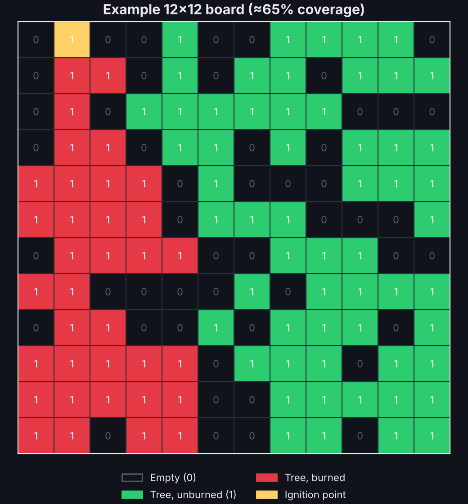
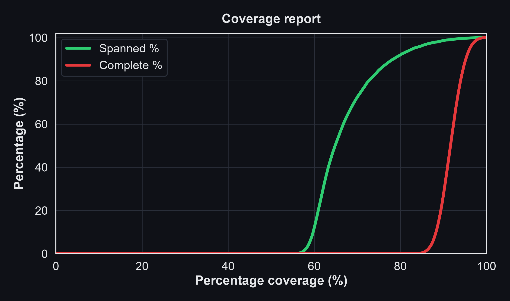

# PyroPhase

A Monte Carlo simulation of fire spreading through a randomly populated forest. PyroPhase sweeps tree density from an
empty board to a full one and measures, at each density, how often a fire ignited at the top of the forest burns all the
way to the bottom. This is a site-percolation experiment, and the output shows the sharp phase transition where the fire
suddenly becomes able to span the grid.

## How it works

The forest is an `N × N` grid (default `100 × 100`). Each cell is either a tree or empty.

1. **Generate boards.** For each density level, random boards are generated with exactly that many trees placed
   uniformly at random.
2. **Ignite.** The fire starts at the first tree in row-major order (topmost row, then leftmost column).
3. **Spread.** Fire spreads to trees in the 4 neighbouring cells (up, down, left, right) until it can spread no further.
4. **Measure.** Two outcomes are recorded per board:
    - **Spanned:** the fire reached the bottom row.
    - **Complete:** every tree on the board burned (independent of spanning).
5. **Aggregate.** Results are averaged across all boards at each density and written to CSV.

### Example board

A random 12×12 board at roughly 65% tree coverage, shown as the matrix the simulation works on (`1` = tree, `0` =
empty). The fire starts at the first tree in row-major order (yellow) and spreads through 4-neighbour trees (red). Here
it reaches the bottom row, so this board counts as **spanned** but not **complete**, because some trees on the right are
never reached.



```
0 1 0 0 1 0 0 1 1 1 1 0
0 1 1 0 1 0 1 1 0 1 1 1
0 1 0 1 1 1 1 1 1 0 0 0
0 1 1 0 1 1 0 1 0 1 1 1
1 1 1 1 0 1 0 0 0 1 1 1
1 1 1 1 0 1 1 1 0 0 0 1
0 1 1 1 1 0 0 1 1 1 0 0
1 1 0 0 0 0 1 0 1 1 1 1
0 1 1 0 0 1 0 1 1 1 0 1
1 1 1 1 1 0 1 1 1 0 1 1
1 1 1 1 1 0 0 1 1 1 1 1
1 1 0 1 1 0 0 1 1 0 1 1
```

### Results

Running the simulation across all coverage levels gives the curves below. Fire almost never spans the board below about
58% coverage, then the chance of spanning climbs steeply. Boards where every tree burns only appear much later, above
roughly 85% coverage.



## Project structure

| File                 | Purpose                                                                                          |
|----------------------|--------------------------------------------------------------------------------------------------|
| `engine.py`          | Entry point. Configures the experiment, distributes work across CPU cores, and writes results.   |
| `Board_Generator.py` | `BoardGenerator`: produces batches of unique random boards at a chosen tree density.             |
| `Fire_Solver.py`     | `FireSolver`: simulates fire spread for a single board (bitboard) or a batch (vectorised NumPy). |
| `Results/`           | Output CSVs. `output_run_1.csv` is a sample run.                                                 |
| `images/`            | Figures used in this README.                                                                     |
| `requirements.txt`   | Pinned Python dependencies.                                                                      |

## Getting started

### Installation

```bash
git clone https://github.com/BL4Z23/PyroPhase.git
cd PyroPhase
python -m venv .venv
source .venv/bin/activate   # Windows: .venv\Scripts\activate
pip install -r requirements.txt
```

The simulation itself only needs NumPy. The remaining packages in `requirements.txt` (matplotlib, pandas, seaborn, etc.)
are useful for plotting and analysing the results.

### Running

Run from the repository root so the output path resolves correctly:

```bash
python engine.py
```

Progress is printed as batches complete. When the run finishes, results are written to `Results/output.csv`.

## Configuration

All parameters are constants at the top of `engine.py`:

| Constant            | Default          | Description                                                       |
|---------------------|------------------|-------------------------------------------------------------------|
| `SIZE_OF_BOARDS`    | `100`            | Board side length (board is `N × N`).                             |
| `NUMBER_OF_SAMPLES` | `10000`          | Target number of boards simulated per density level.              |
| `BATCH_SIZE`        | `500`            | Boards generated and solved per task.                             |
| `DIVISIONS`         | `1000`           | Number of density levels, evenly spaced from 0% to 100% coverage. |
| `CAPPED_GENERATION` | `True`           | Cap the number of boards per level (see note below).              |
| `SEED`              | `42`             | Base random seed. Set to `None` for a fresh random seed each run. |
| `WORKERS`           | `os.cpu_count()` | Number of worker processes.                                       |

For level `i`, the number of trees is `round(N² · i / (DIVISIONS − 1))`. Levels with very few possible distinct boards (
for example, an empty or completely full board) are simulated once rather than repeated.

Runs are reproducible: with a fixed `SEED`, each task derives its own random generator from
`(seed, density level, batch)`, so results do not depend on how work is scheduled across workers.

> **Note:** Running the defaults (1000 levels × 10,000 boards on a 100 × 100 grid) is computationally heavy. For a quick
> test, try lowering `DIVISIONS` and `NUMBER_OF_SAMPLES`.

## Output

`Results/output.csv` has one row per density level, in increasing order of coverage:

| Column                | Meaning                                                     |
|-----------------------|-------------------------------------------------------------|
| `PERCENTAGE COVERAGE` | Percentage of cells that are trees.                         |
| `SPANNED PERCENTAGE`  | Percentage of boards where the fire reached the bottom row. |
| `COMPLETE PERCENTAGE` | Percentage of boards where every tree burned.               |

Plotting `SPANNED PERCENTAGE` against `PERCENTAGE COVERAGE` shows the transition from fires that die out early to fires
that cross the whole forest.

Example plot:

```python
import pandas as pd
import matplotlib.pyplot as plt

df = pd.read_csv("Results/output.csv")
plt.plot(df["PERCENTAGE COVERAGE"], df["SPANNED PERCENTAGE"], label="Spanned")
plt.plot(df["PERCENTAGE COVERAGE"], df["COMPLETE PERCENTAGE"], label="Complete")
plt.xlabel("Tree coverage (%)")
plt.ylabel("Boards (%)")
plt.legend()
plt.show()
```

## Using the components directly

```python
from Board_Generator import BoardGenerator
from Fire_Solver import FireSolver

gen = BoardGenerator(board_size=12, number_of_boards=1000, divisions=100, seed=1)
solver = FireSolver(n=12)

boards = gen[60]  # boards at density level 60 of 100
results = solver.solve_batch(boards)  # shape (N, 2): [spanning, complete]
print(results.mean(axis=0))
```